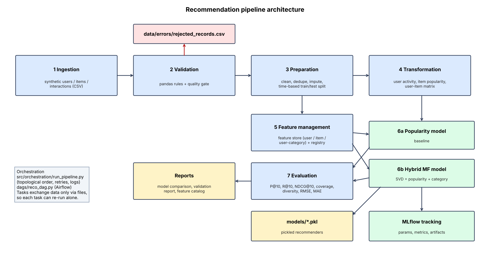

# Recommendation Data Pipeline

End-to-end, reproducible pipeline for an e-commerce recommender:
**Ingestion → Validation → Preparation → Transformation → Feature Management → Training (2 models) → Evaluation → Orchestration.**



## Quick start
Requires Python 3.10+.
```bash
git clone https://github.com/sunitbits/reco_pipeline.git && cd reco_pipeline
python -m venv venv && source venv/bin/activate      # Windows: venv\Scripts\activate
pip install -r requirements.txt
python -m src.orchestration.run_pipeline             # full run, about 15 s (same as: python main.py)
python -m src.training.predict U0001 --k 10          # recommendations for one user (feature store + trained model)
pytest -q                                            # unit tests (run the pipeline once first)
mlflow ui --backend-store-uri sqlite:///mlflow.db    # experiment tracking UI at http://127.0.0.1:5000
```
Useful options: `--list` (task graph), `--only evaluate --with-deps`, `--retries 2`. Set `RECO_SEED` to change the synthetic data seed (default 42; results are deterministic).

## Data
Documented **synthetic** e-commerce data (1,500 users, 600 items, 8 categories, ~58k rating events, 2023-2024) generated from latent
user/item factors with popularity-biased exposure, so personalised models have real signal. Deliberate errors are injected
(nulls, duplicates, invalid ratings/timestamps/types, orphan keys) so validation has work to do. To use MovieLens or Amazon Reviews,
replace `generate_synthetic()` in `src/ingestion/ingest.py` with a loader returning the same three tables.

## Project structure
```
recommendation-pipeline/
├── configs/settings.py          paths, K, split, quality-gate thresholds
├── data/{raw,processed,features,errors}/
├── src/
│   ├── ingestion/ingest.py              synthetic data + injected dirt
│   ├── validation/validate.py           rule checks, error dataset, quality gate, report
│   ├── preparation/prepare.py           clean, dedupe, impute, time-based split
│   ├── transformation/transform.py      user activity, item popularity, user-item matrix
│   ├── features/feature_store.py        feature store + registry + catalog
│   ├── training/{models,train,tracking,predict}.py   popularity + hybrid MF, MLflow tracking, single-user prediction
│   ├── evaluation/evaluate.py           P/R/NDCG@10, coverage, diversity, RMSE/MAE
│   └── orchestration/{run_pipeline,make_diagram}.py
├── dags/reco_dag.py             Airflow DAG (same task graph)
├── models/                      saved models
├── reports/                     reports, diagram, screenshots, final report
└── tests/test_pipeline.py
```

## Orchestration
Scheduling: the Airflow DAG is set to `@daily`. Without Airflow, schedule the same command with cron (`0 2 * * * cd /path/reco_pipeline && venv/bin/python main.py`) or Windows Task Scheduler.

`run_pipeline.py` orders tasks with a topological sort (`graphlib`), retries failures, logs to `reports/pipeline.log`
and writes `reports/run_status.json`. Tasks communicate only through files, so each one can be re-run alone.
```
ingest -> validate -> prepare -> [transform, build_features] -> [train_popularity, train_hybrid] -> evaluate
```
`dags/reco_dag.py` builds the identical graph for Apache Airflow (`PYTHONPATH` = repo root). Evidence of a successful run: `reports/screenshots/01_*` and `02_*` (terminal captures from the first run, before the folders were reorganised, so the command shown is the old `reco.run_pipeline`) and `09_run_summary.png` (rendered from the current run log).

## Results (K = 10, time-based test set, 1,360 evaluated users)
| model      |   precision@10 |   recall@10 |   ndcg@10 |   coverage |   diversity |   rmse |    mae |   n_eval_users |
|:-----------|---------------:|------------:|----------:|-----------:|------------:|-------:|-------:|---------------:|
| popularity |         0.0983 |      0.2094 |    0.1897 |     0.0626 |      0.9348 | 0.889  | 0.7263 |           1360 |
| hybrid_mf  |         0.1176 |      0.223  |    0.2138 |     0.154  |      0.8824 | 0.8335 | 0.6578 |           1360 |
The hybrid model beats the popularity baseline on every metric except diversity. Details: `reports/final_report.pdf`.

## Data validation report

| Table | Input rows | Valid rows | Rejected | Reject rate |
|---|---:|---:|---:|---:|
| users | 1505 | 1493 | 12 | 0.80% |
| items | 603 | 591 | 12 | 1.99% |
| interactions | 58715 | 54212 | 4503 | 7.67% |

## Rejections by reason

| Table | Reason | Rows |
|---|---|---:|
| users | duplicate_user_id | 5 |
| users | age_out_of_range | 4 |
| users | invalid_signup_date | 3 |
| items | missing_category | 4 |
| items | duplicate_item_id | 3 |
| items | non_positive_price | 3 |
| items | invalid_type_price | 2 |
| interactions | orphan_item_id | 1706 |
| interactions | duplicate_interaction | 562 |
| interactions | orphan_user_id | 470 |
| interactions | missing_rating | 295 |
| interactions | rating_out_of_range | 295 |
| interactions | invalid_timestamp_format | 295 |
| interactions | timestamp_out_of_range | 295 |
| interactions | invalid_type_rating | 293 |
| interactions | missing_user_id | 292 |

Warnings (kept, handled in preparation): {'users_missing_age': 8}
Quality gate: pipeline fails if any table reject rate > 10%.
Rejected records with reasons: `data/errors/rejected_records.csv`. Note: orphan_item_id / orphan_user_id include interactions whose parent row was itself rejected (cascade).

Full machine-readable version: `reports/validation_report.json`.

## Feature catalog
| Feature | Entity | Type | Description |
|---|---|---|---|
| `user_activity_count` | user | int | Number of training interactions |
| `user_avg_rating` | user | float | Mean rating given by the user |
| `user_rating_std` | user | float | Std-dev of the user's ratings (0 if single rating) |
| `user_positive_ratio` | user | float | Share of the user's ratings >= 4 |
| `preferred_category` | user | str | Category with most interactions |
| `days_since_last_interaction` | user | int | Days from user's last interaction to ref_time |
| `user_tenure_days` | user | int | Days from signup to ref_time |
| `item_popularity` | item | int | Number of training interactions |
| `item_positive_count` | item | int | Number of ratings >= 4 |
| `item_popularity_pct` | item | float | Percentile rank of popularity (1 = most popular) |
| `item_avg_rating` | item | float | Bayesian-smoothed mean rating (m=10) toward global mean |
| `item_days_since_last_interaction` | item | int | Days since the item was last interacted with |
| `category / brand / price` | item | str/float | Item content attributes |
| `user_category_avg_rating` | user x category | float | User's mean rating within a category |
| `user_category_count` | user x category | int | User's interactions within a category |
| `user_category_affinity (derived)` | interaction | float | user_category_avg_rating for the item's category, else user_avg_rating |
| `rating_gap (derived)` | interaction | float | item_avg_rating - user_avg_rating |
| `is_preferred_category (derived)` | interaction | int | 1 if item category == user's preferred_category |

Same table: `reports/feature_catalog.md`; registry JSON: `data/features/feature_registry.json`.

## Experiment tracking (MLflow)
Each model logs parameters, metrics and artifacts (model file, feature registry). Screenshots: `reports/screenshots/05-08_*`.

## Design decisions and limitations
* Time-based split (latest 20% of time is test) and train-only features avoid leakage.
* Relevant item = rating >= 4; items a user already rated are never recommended.
* Hybrid blend weights were chosen from a small grid scored on the test set, so its gain is slightly optimistic; production should tune on a validation window.
* Synthetic data is popularity-biased and clean in structure; real data will behave differently. CSV storage and a local SQLite MLflow store keep the project dependency-light.
